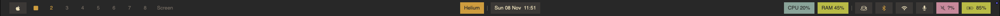
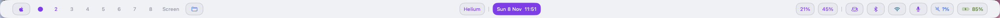
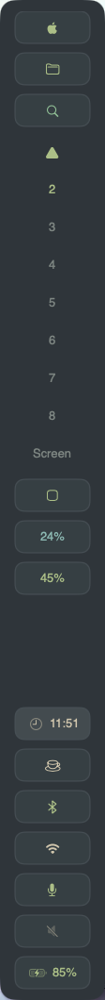

# Theme gallery

[Project home](../../README.md) · [Get started](../../docs/user/quickstart.md) · [Customize](../../docs/user/customization.md) · [Configuration reference](../../docs/user/configuration.md)

Choose a complete TOML configuration, preview it, then make it your own. All themes use native macOS controls, system fonts and SF Symbols. No plugin, shell script or Nerd Font is required.

The **eight workspace configurations require Rill 0.2.0 or newer** for their minimum module sizing options. All include live OmniWM workspaces; the six showcase layouts below demonstrate the full native control set, while Convex Style and Catppuccin use more compact selections. If you want to start without a window manager, use one of the [standalone configurations](#start-without-a-window-manager) or remove the workspace integration as described below.

## Showcase layouts

These are real captures from the development build on a 2560 × 1080 display at 1× scale. Click an image to inspect it at full size. Readings reflect the capture machine; unavailable values appear as `?` rather than zero.

### Tokyo Night Pills

[](previews/tokyo-night-pills.png)

[Use this configuration](tokyo-night-pills.toml). Floating top bar with individually outlined capsules, live application icons and a blue active workspace. Its transparent surface leaves the wallpaper visible between groups.

### Nord Glass

[](previews/nord-glass.png)

[Use this configuration](nord-glass.toml). A thin-material surface with icy accents, glass workspace capsules and aligned status controls. Native glass is available on macOS 26+, with a translucent fallback on earlier versions; wallpaper and accessibility settings affect the result.

### Gruvbox Blocks

[](previews/gruvbox-blocks.png)

[Use this configuration](gruvbox-blocks.toml). A continuous top strip with square corners, warm colors and spaced rectangular blocks. The active workspace uses a square instead of an application capsule.

### Mono Minimal

[](previews/mono-minimal.png)

[Use this configuration](mono-minimal.toml). A thin monochrome top bar without visible module capsules. Dots represent workspaces, with an elongated active indicator; status controls retain their native actions and tooltips.

### Latte Bottom

[](previews/latte-bottom.png)

[Use this configuration](latte-bottom.toml). A light bottom bar with soft gray capsules, violet accents and a Finder launcher. A circle marks the active workspace. Status accents use darker colors for readability on the light surface.

### Everforest Rail

<a href="previews/everforest-rail.png"></a>

[Use this configuration](everforest-rail.toml). A 112-point side rail with Finder and Spotlight launchers, a horizontal clock, live metrics and system controls. A triangle marks the active workspace. The upper group scrolls when needed; hover for details and click CPU to open Activity Monitor.

## More workspace layouts

### Convex Style

[](previews/convex-style.png)

[Use this configuration](convex-style.toml). Compact black islands in the system menu-bar area, with curved cutouts around the workspace/application and status groups. Workspaces show application icons and a violet active indicator. Enable macOS menu-bar auto-hide to use this placement, and connect the OmniWM provider as described below.

### Catppuccin

[](previews/catppuccin.png)

[Use this configuration](catppuccin.toml). A floating top bar inspired by Catppuccin Mocha, with violet workspace selection and application text, a yellow clock and blue/green metrics. It sits below the system menu bar and uses the same OmniWM provider as the other workspace configurations.

## Start without a window manager

These complete configurations use only built-in modules:

| Configuration | Appearance | Placement |
| --- | --- | --- |
| [macOS glass](macos-glass.toml) | System typography and native glass styling | System menu-bar area |
| [Default bar](../default/config.toml) | Native app, clock and system controls | System menu-bar area |
| [Quickstart example](../../docs/user/quickstart.md#make-your-first-edit) | A small editable native bar | Floating below the system menu bar |

For the menu-bar-area configurations, enable macOS menu-bar auto-hide yourself. On a notched display in that mode, center content joins the right group. The quickstart's floating bar leaves the system menu bar visible. To use any workspace theme without a manager, remove its workspace integration as described below.

## Preview a theme

From a current Rill checkout, [build the development app](../../README.md#build-from-source). Quit any running Rill instance through its status menu before previewing a different configuration.

From the repository root, validate and launch Tokyo Night Pills:

```sh
rill_app=".build/DerivedData/Build/Products/Debug/Rill.app"
"$rill_app/Contents/Resources/bin/rillctl" validate --config Examples/themes/tokyo-night-pills.toml
"$rill_app/Contents/MacOS/Rill" --config Examples/themes/tokyo-night-pills.toml
```

Replace the filename to try another theme. Validation checks the configuration without running providers; live workspaces also need a running, configured manager. If the CLI reports unknown keys such as `module_min_width`, update to Rill 0.2.0 or newer, or use the current source build.

For an installed app that supports your chosen file, use the absolute paths instead:

```sh
/Applications/Rill.app/Contents/Resources/bin/rillctl validate --config /absolute/path/to/config.toml
/Applications/Rill.app/Contents/MacOS/Rill --config /absolute/path/to/config.toml
```

Quit the preview before returning to your usual Rill app. An explicit `--config` does not replace your personal file. To keep a theme, back up the configuration opened through **Rill ◇ > Open Configuration**, then copy in the chosen theme's contents. Valid saved edits reload automatically; invalid ones keep the last working bar visible.

## Connect the workspaces

All eight workspace configurations use `/Applications/OmniWM.app/Contents/MacOS/omniwmctl`. Follow the [OmniWM setup](../../docs/user/omniwm.md), enable its IPC and verify that this exact CLI can query the running app:

```sh
/Applications/OmniWM.app/Contents/MacOS/omniwmctl query workspaces --format json
```

For another installation, change `[[providers]].executable` to the absolute CLI path bundled with your running OmniWM. An older installed CLI may be incompatible with OmniWM Dev. OmniWM requires macOS 26+, while Rill's native controls support macOS 14+.

| Your setup | Adapt the configuration |
| --- | --- |
| OmniWM | Keep the provider and set the matching executable path. |
| AeroSpace | Replace the provider using the [AeroSpace guide](../../docs/user/aerospace.md), then update the `spaces` module's `provider` ID. |
| yabai | Replace the provider using the [yabai guide](../../docs/user/yabai.md), then update the `spaces` module's `provider` ID. |
| No window manager | Remove `spaces` from the surface, remove its module table and remove the OmniWM provider table. |

Workspace clicks focus the chosen space. Hover shows applications and window counts. The `standard` variant also shows application icons and the focused app name. Dots and Omarchy shapes retain switching and accessibility while using less room. Square, circle and triangle variants are fixed visual choices; they do not detect or change the manager's layout. Empty spaces are dimmed, and unavailable IPC is reported visibly.

## Try the native controls

Every showcase includes Apple and application menus, clock/calendar, CPU, RAM, keep awake, Bluetooth, Wi-Fi, microphone, volume and battery. Horizontal layouts put workspaces on the left, the app and clock in the center, and metrics and controls on the right.

- Click clock, connectivity, audio or battery modules to open their native details and controls.
- Scroll volume to adjust it in five-percentage-point steps when the device supports it.
- Click CPU or RAM for measurement details; Everforest's CPU instead opens Activity Monitor.
- Apple and frontmost-app menus need Accessibility permission when used. Showing the app name alone does not.
- Bluetooth may request Bluetooth access. The microphone control does not record audio or request recording permission.
- The keep-awake popup starts inactive; displaying the theme does not enable it.

See the [module guide](../../docs/user/modules.md) for each module's behavior and hardware limits.

## Adjust placement and density

All six showcase themes leave the system menu bar in place. `display = "all"` mirrors the bar; choose `"primary"` for one screen. The bottom layout follows the system-visible area, including room occupied by a visible Dock. Rill does not reserve window-manager gaps automatically.

Horizontal groups each receive one third of the available width. On a smaller display, use `workspace_variant = "dot"` or `"omarchy"`, reduce `spacing` and `module_padding`, or set volume/battery `format = ""`. Tooltips and accessible readings still expose the values.

The layouts use explicit minimum module dimensions to align short symbols with text capsules. Longer labels grow naturally. Nord explicitly sizes Apple and battery symbols instead of inheriting their enlarged glass-preset sizes.

| Theme | Bar height or rail width | Minimum module width × height | Module gap | Workspace gap |
| --- | --- | --- | --- | --- |
| Convex Style | System-derived | 28 × 24 | 8 | 6 |
| Catppuccin | 36 | 32 × 26 | 8 | 6 |
| Mono Minimal | 36 | 30 × 28 | 12 | 8 |
| Tokyo Night Pills | 48 | 44 × 32 | 10 | 8 |
| Gruvbox Blocks | 42 | 44 × 30 | 8 | 8 |
| Nord Glass | 48 | 44 × 30 | 10 | 8 |
| Everforest Rail | 112 | 80 × 34 | 10 | 6 |
| Latte Bottom | 48 | 44 × 32 | 10 | 8 |

Dimensions are in points and module minima include padding. Use `animation_ms = 0` to disable workspace motion; macOS Reduce Motion also disables it. For more options, follow [Customize your bar](../../docs/user/customization.md), the [configuration reference](../../docs/user/configuration.md) and [surface placement](../../docs/user/surfaces.md).

## Inspiration and sharing

These are Rill-native interpretations of recurring designs in [HANCORE's Waybar themes](https://github.com/HANCORE-linux/waybar-themes), [Atif's minimal themes](https://github.com/atif-1402/minimal-waybar-themes), [Owlphin](https://github.com/lepz0r/owlphin) and [Omarchy's palettes](https://omarchy.org/manual/themes/). They are not CSS or QML ports. No upstream theme code or wallpaper files are bundled.

Share your TOML, a screenshot and the required host, manager and plugin versions. See [contributing](../../CONTRIBUTING.md#share-a-theme-or-plugin) for the details that make a setup easy to reproduce.
