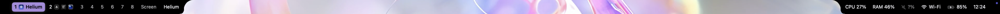
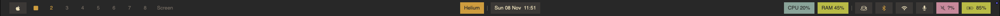
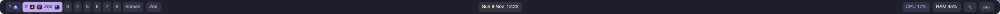

# Rill

A configurable native desktop bar for macOS. Compose your bar in TOML, connect your workspaces, and add your own scripts. Rill brings Waybar-style customization to native macOS controls.

[Install](docs/user/installation.md) · [Get started](docs/user/quickstart.md) · [Theme gallery](Examples/themes/README.md) · [Documentation](docs/README.md) · [Contribute](CONTRIBUTING.md)

[](Examples/themes/README.md#convex-style)

*Convex Style*

[](Examples/themes/README.md#gruvbox-blocks)

*Gruvbox Blocks*

[](Examples/themes/README.md#catppuccin)

*Catppuccin-inspired. All three are real captures from the development build. [Explore the theme gallery](Examples/themes/README.md).*

## Make it yours

- **Native controls:** calendar, application and Apple menus, Wi-Fi, Bluetooth, output volume, microphone, keep awake, battery, CPU and RAM.
- **Live workspaces:** switch spaces through [AeroSpace](docs/user/aerospace.md), [OmniWM](docs/user/omniwm.md) or [yabai](docs/user/yabai.md). AeroSpace and OmniWM can show application icons inside workspaces.
- **Your layout:** top, bottom, left or right; one display or all of them; continuous bars, individual capsules, glass and Convex Style.
- **Your data:** command, stream and event modules, packaged plugins, and experimental rich UI extensions for notch and edge widgets.
- **Fast iteration:** edit and save your configuration to reload it. Invalid edits keep the last working bar visible.

Built-in modules work without scripts or a window manager. System fonts and SF Symbols are included; no Nerd Font is needed. Keyboard access, VoiceOver and Reduce Motion follow the native controls.

## Install and launch

Requires **Apple Silicon and macOS 14 or newer**. The current release is locally signed and is **not notarized**; follow the [first-launch instructions](docs/user/installation.md#first-launch) if macOS blocks it.

With Homebrew:

```sh
brew tap AleckAstan/rill
brew install --cask AleckAstan/rill/rill
rillctl init
open -a Rill
```

`rillctl init` creates your configuration and refuses to overwrite an existing file. If you already have one, skip that command. Prefer a direct download? Use the [DMG installation guide](docs/user/installation.md).

Open the **Rill ◇** status menu and choose **Open Configuration** to edit your bar. The starter uses the system menu-bar area; enable macOS menu-bar auto-hide, or follow the [quickstart](docs/user/quickstart.md) for a floating bar that leaves it in place.

The eight workspace configurations require Rill 0.2.0 or newer, including support for `module_min_width` and `module_min_height`. Use the current release through Homebrew or the DMG, or [build from source](#build-from-source) for development changes. Liquid Glass needs macOS 26+ and falls back to translucent styling on older systems. OmniWM has its own macOS 26+ requirement.

## Choose a look

| Theme | Layout | Workspace style |
| --- | --- | --- |
| [Convex Style](Examples/themes/convex-style.toml) | Black attached islands with curved cutouts | Labels and application icons |
| [Catppuccin-inspired](Examples/themes/catppuccin.toml) | Floating Mocha-colored capsules | Labels and application icons |
| [Mono Minimal](Examples/themes/mono-minimal.toml) | Thin monochrome top bar | Dots |
| [Tokyo Night Pills](Examples/themes/tokyo-night-pills.toml) | Floating colored capsules | Labels and application icons |
| [Gruvbox Blocks](Examples/themes/gruvbox-blocks.toml) | Warm rectangular blocks | Active square |
| [Nord Glass](Examples/themes/nord-glass.toml) | Frosted blue-gray surface | Labels and application icons |
| [Everforest Rail](Examples/themes/everforest-rail.toml) | Vertical rail with launchers | Active triangle |
| [Latte Bottom](Examples/themes/latte-bottom.toml) | Light bottom bar | Active circle |

All eight configurations include live OmniWM workspaces. The six showcase layouts demonstrate the full native control set; Convex Style and Catppuccin use a more compact selection. The [gallery](Examples/themes/README.md) explains how to preview them, adapt their workspace provider, or start with a configuration that needs no window manager.

## Configure your bar

The usual configuration file is `~/.config/rill/config.toml`. Rill watches it for changes. A surface arranges module IDs in three groups:

```toml
start = ["spaces", "frontmost"]
center = ["clock"]
end = ["cpu", "memory", "wifi", "volume", "battery"]
```

These are entries in a `[[surfaces]]` table; each ID references a `[[modules]]` table. Built-in modules provide their own data. Workspaces and custom modules connect to a configured provider.

Start with the [complete first-bar example](docs/user/quickstart.md#make-your-first-edit), then follow [Customize your bar](docs/user/customization.md) to add modules, style states and connect your own data.

| I want to… | Go to |
| --- | --- |
| Pick modules and learn their click actions | [Module guide](docs/user/modules.md) |
| Change colors, sizing or mouse actions | [Configuration reference](docs/user/configuration.md) |
| Move the bar or use multiple displays | [Surface placement](docs/user/surfaces.md) |
| Add workspace switching | [AeroSpace](docs/user/aerospace.md), [OmniWM](docs/user/omniwm.md), [yabai](docs/user/yabai.md) |
| Write a script or package a data module | [Custom producers](Examples/custom/README.md), [plugin guide](docs/user/plugins.md) |
| Build a richer panel or notch widget | [UI extensions](docs/user/extensions.md), experimental API v2 |
| Diagnose a problem | [Troubleshooting](docs/user/troubleshooting.md) |

## Build from source

Use a full Xcode installation with the macOS 26 SDK or newer, with its command-line tools selected:

```sh
git clone https://github.com/AleckAstan/Rill.git
cd Rill
./scripts/build.sh
```

The app is written to `.build/DerivedData/Build/Products/Debug/Rill.app`, including `Contents/Resources/bin/rillctl`. Quit any running Rill instance before launching this build:

```sh
open .build/DerivedData/Build/Products/Debug/Rill.app
```

Run `./scripts/test.sh` for the Xcode tests. See [contributing](CONTRIBUTING.md) for focused checks, [release preparation](docs/user/homebrew.md) for packaging, and [release verification](docs/github-release-verification.md) for recorded installation and runtime results.

## Share your setup

Share a screenshot and your TOML, report a reproducible [issue](https://github.com/AleckAstan/Rill/issues), or improve an example or guide. The [contribution guide](CONTRIBUTING.md) explains what to include so others can reproduce your setup.

Inspired by [Waybar](https://github.com/Alexays/Waybar) and the macOS bar customization community, including [SketchyBar](https://github.com/FelixKratz/SketchyBar).
