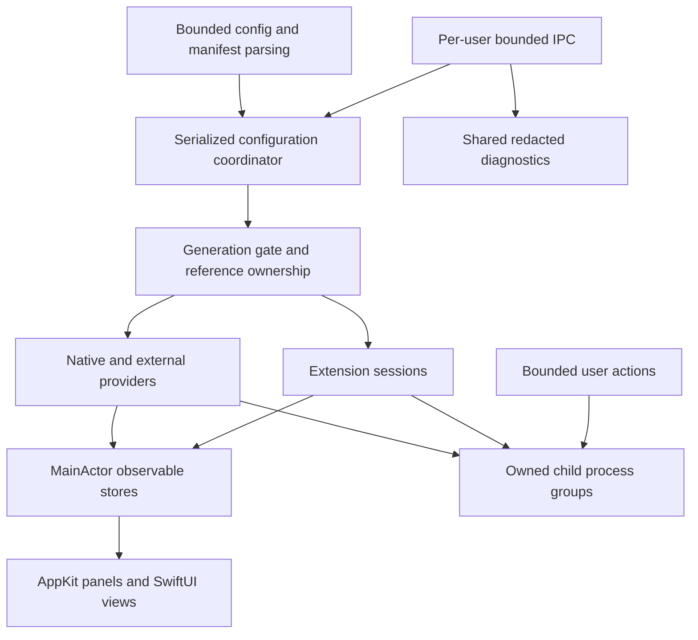

# Production readiness review — 2026-09-27

Rill's useful features are retained, including the owner-approved notch UI.
The architecture is viable for a desktop product; the current build is a
release candidate under verification, not yet a publicly validated release.
This review resumes phase 10. It does not silently complete earlier hardware
checks or promote the extension API to stable.

## Runtime boundaries

The source directories are responsibility boundaries in one app target, not
independent binary frameworks. The SDK is separately buildable; the CLI has its
own product. Splitting all directories into frameworks would not by itself fix
lifecycle races. This pass establishes explicit ownership and regression tests
at the actual asynchronous boundaries first.

## Findings addressed

| Finding | Change and evidence |
| --- | --- |
| Actor reentrancy let reload transactions interleave across awaits | FIFO serialized apply/stop; unique generations; shutdown rejects later work; concurrent reload test |
| Providers could publish before the new generation was active | Activation callback switches the generation gate before commit; delayed data queues cleared during activation |
| Retiring modules removed a binding still used by their replacements | Reference counts per provider/module pair; 100 valid/invalid replacement cycles with data delivery after final replacement |
| Duplicate plugin IDs or duplicate yabai identities could trap before validation | Checked lookup construction and manager normalization; field/duplicate identity tests |
| Configuration reads were unbounded and on the UI thread; invalid startup lost its watcher | 1 MiB regular-file input, off-main load, persistent recovery watcher; runtime repair scenario |
| Reload CLI reported success for rejected config | Explicit `reload_rejected`, exit 4; integration scenario |
| Child process group assignment after launch was racy | Shared `ManagedChildProcess` uses posix_spawn process-group attributes, resets child signals, owns pipe ends and reaps children |
| Descendants could hold stdout/stderr after leader exit | Remaining group members killed on leader exit; descendant test and shutdown integration check |
| Actions had no concurrency/shutdown owner | Eight in-flight action limit; supervised cleanup on app shutdown |
| Extension stdin writes could block MainActor | Nonblocking writes, protocol failure/recovery on backpressure; non-reading child test |
| Retired extension failures could overwrite new health | Failure events scoped by generation; regression test |
| Unbounded per-frame tasks under producer floods | Latest-value AsyncStream buffer; oversized complete lines rejected before delivery |
| IPC performed a syscall per byte and allowed slow clients to reset timeouts | 4 KiB reads, total frame deadline, 16 client admission bound, runtime ownership lock, reply-ID check; trickle/flood tests |
| Redacted exports included arbitrary text inside failed provider health | Shared allowlisted serializer for UI/CLI; private sentinel test |
| A duplicate app could start bars/providers after failing socket ownership | Fail closed before resource startup; isolated second-instance test |
| Release included smoke/config-mutation commands | DEBUG-only compilation; Release binary string inspection |
| Repeated media updates decoded full artwork unnecessarily | 512-pixel thumbnails and 16 MiB/64-entry decoded-image cache |
| SIGTERM cleanup could deadlock inside AppKit's nested termination loop | Schedule terminate after leaving the dispatch callback; full Release integration rerun |

## Product and API exposure

- Config schema 1 and provider plugin API 1 remain supported, with documented
  stricter failure handling and bounded input.
- Schema 2 / UI extension API 2 remain a preview. RillNotch proves real
  integration but depends on host semantic media rendering. A second extension
  authored from the public SDK/docs without changing Rill is still needed to
  demonstrate general authoring completeness.
- RichSample, Hello, PanelProbe and demo configurations remain development
  examples. They are not bundled into the Release app and are not enabled by
  the no-manager default. Removing them would discard useful verification and
  authoring material. Debug-only smoke code remains available for testing.
- Existing personal configuration is not silently stripped of its explicitly
  installed examples or extensions.
- Launch at login now has an explicit SMAppService status-menu action. It is
  never enabled during startup/reload. Fresh-login behavior is still unverified. Release app/CLI build settings now
  enable hardened runtime for the eventual signing step; the local archive
  remains unsigned.
- Local extensions run as the user. Capability grants constrain the host
  protocol, not the executable's ambient operating-system rights. Deliberately
  daemonized workers escaping the owned process group are unsupported.

## Verification and remaining release gates

Run `ci/verify.sh` on the supported Apple Silicon/Xcode toolchain. It builds
Debug, tests the app/IPC and SDK, builds the standalone extension sample,
archives Release, rejects shipped debug hooks, validates Rill examples and
runs an isolated 100-cycle runtime recovery/cleanup scenario. It does not
modify the personal configuration or manager configuration.

Evidence and exact outcomes are in the phase-10 handoff. The runtime test uses
its own temporary config, socket and producer. It verifies panel/descriptor/
child counts; it does not claim a complete observer-allocation or Instruments
leak audit.

Public delivery still requires:

1. Phase 11 measurements: long soak, CPU/memory budgets, render latency and
   frame pacing with both ordinary bars and the extension/notch workload.
2. Actual supported-OS matrix (deployment target is macOS 14; current automated
   environment is macOS 27/Xcode 27 arm64), VoiceOver/keyboard/Reduce Motion,
   display hotplug, sleep/wake/session/fullscreen behavior and denied-permission
   paths. A successful build is not compatibility evidence for every OS.
3. Independent SDK authoring and extension context-change checks; preview
   stability/versioning policy before promising a stable extension API.
4. Opt-in login registration/fresh login, clean-user quarantined install,
   upgrade and uninstall validation.
5. Owner-selected license, signing identity, notarization, stapling,
   Gatekeeper acceptance and explicit publication destination/authorization.

Do not describe the unsigned archive as ready for public distribution until
these gates have evidence. Do not remove “preview” labels merely to make the
product look finished.

Final checks also include a relocated clean app/CLI build. The owner session
was relaunched with ready extensions/providers and no configuration error.
Synchronous process tests produce a QoS inversion diagnostic against the
utility-priority reaper; production waits run off MainActor. Include reaper
priority/wakeups in the performance audit rather than claiming zero remaining
performance concerns.
